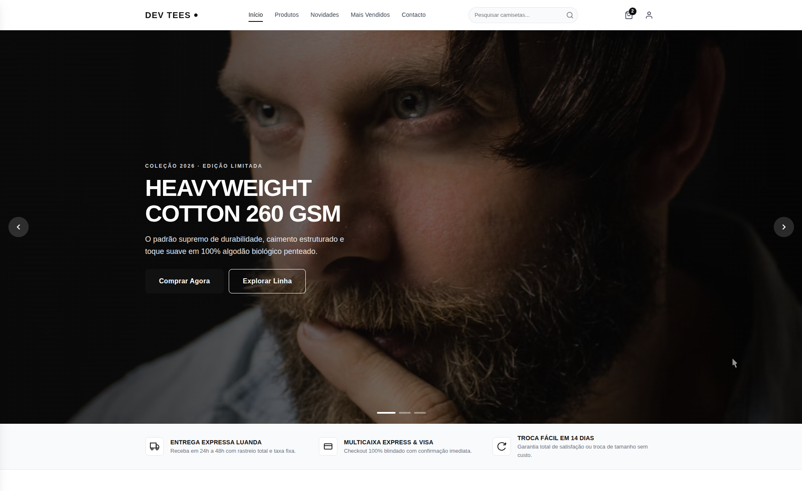
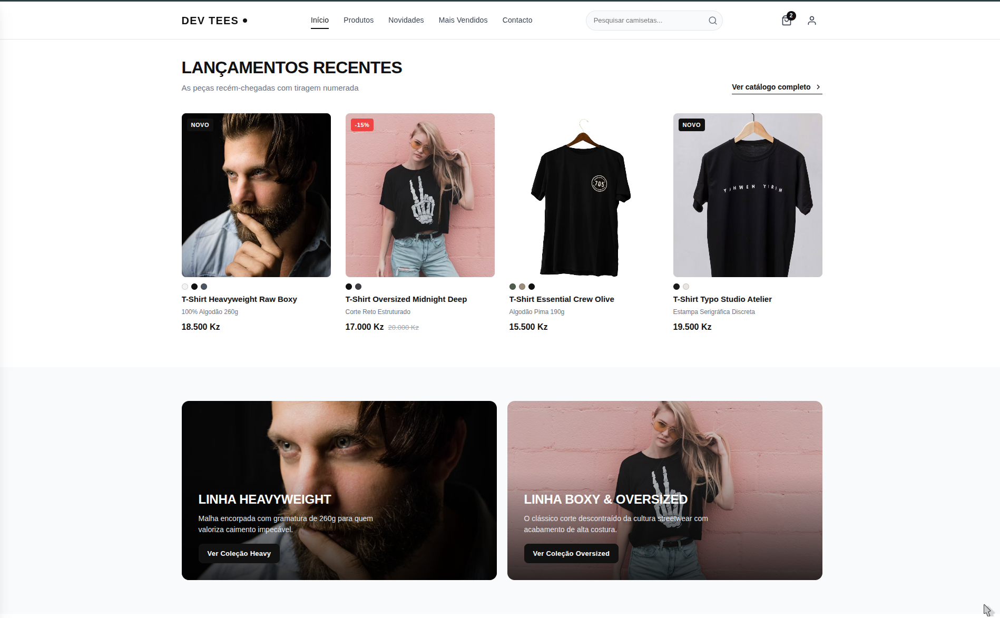
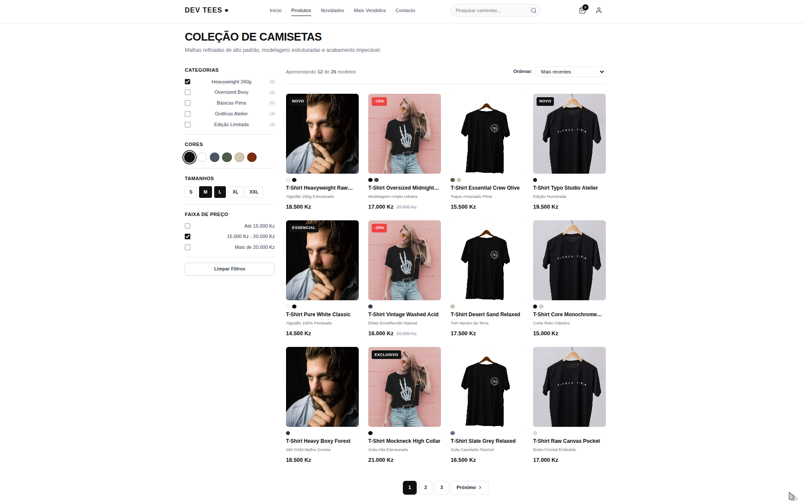
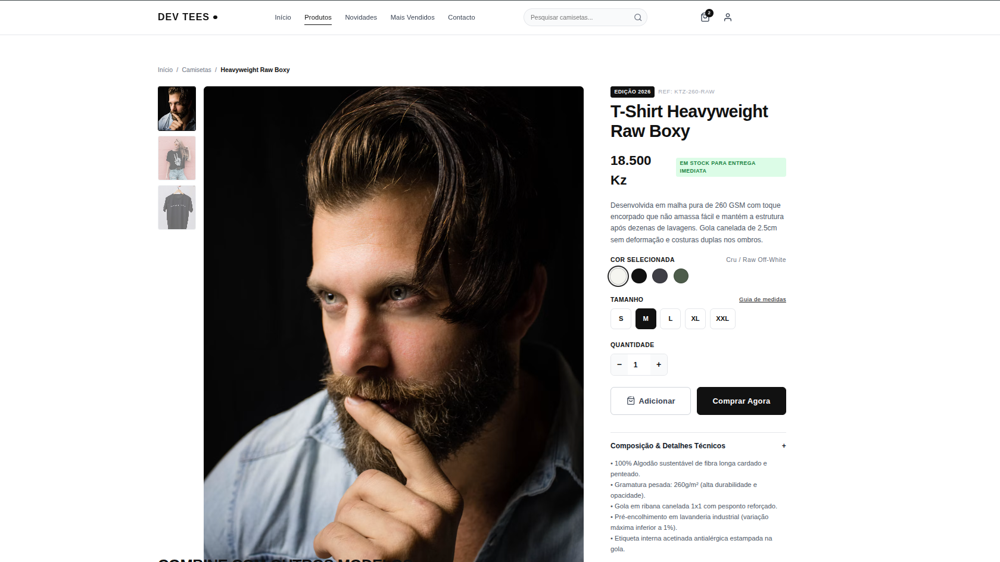
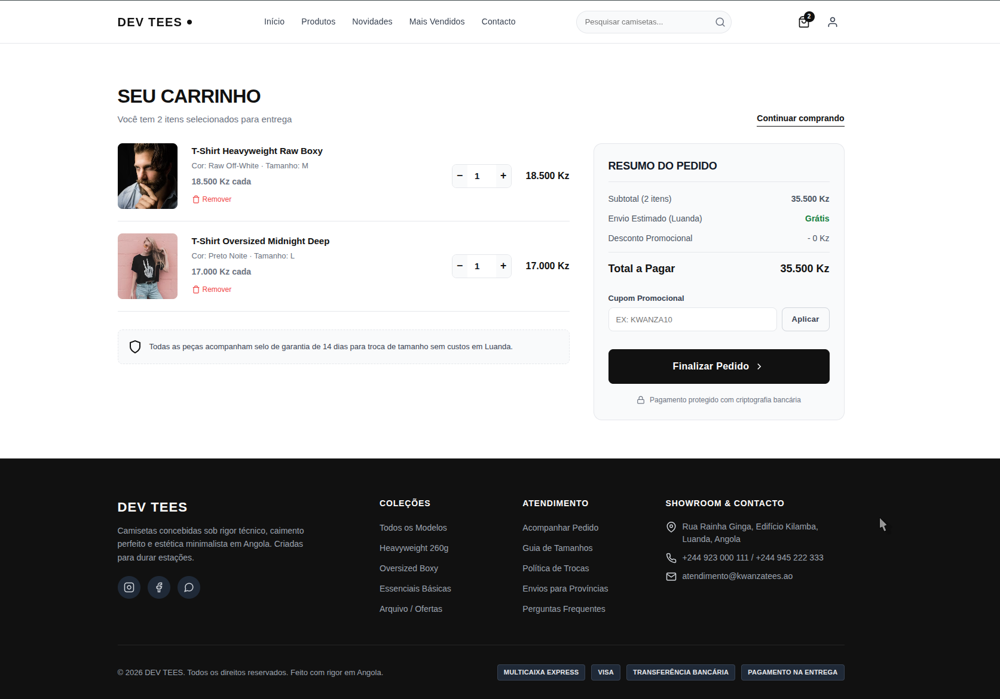

<p align="center">
  
</p>

<h1 align="center">DEV TEES</h1>

<p align="center">
  
  
  
  
  
  
  
</p>

f

<p align="center">
  I built DEV TEES as the storefront I wanted when I started an online shop: a clean, minimal apparel layout in plain HTML, CSS, and JavaScript. I left the backend out on purpose. Drop these pages onto PHP, Go, Node, Java, or any other stack, bind them to your catalog, and you have a shop.
</p>

The sample store sells premium t-shirts. The markup is the template. Swap the products, the currency, and the copy, and it becomes your store.

## Screenshots

<p align="center">
  <a href="screenshot/herosection.png">
    
  </a>
  <br>
  <sub><b>Hero</b> · full-bleed slider with the delivery, payment, and exchange strip</sub>
</p>

<table>
  <tr>
    <td width="50%" align="center">
      <a href="screenshot/home.png">
        
      </a>
      <br>
      <sub><b>Home</b> · latest drops and collection tiles</sub>
    </td>
    <td width="50%" align="center">
      <a href="screenshot/product-filter.png">
        
      </a>
      <br>
      <sub><b>Catalog</b> · filters, sorting, and pagination</sub>
    </td>
  </tr>
  <tr>
    <td width="50%" align="center">
      <a href="screenshot/product_view.png">
        
      </a>
      <br>
      <sub><b>Product</b> · gallery, variants, and fabric specs</sub>
    </td>
    <td width="50%" align="center">
      <a href="screenshot/card.png">
        
      </a>
      <br>
      <sub><b>Cart</b> · line items, promo code, and summary</sub>
    </td>
  </tr>
</table>

<p align="center">
  <sub>Click any image to open it at full size.</sub>
</p>

## What you get

Eight pages, one stylesheet, and a small script. No framework, no build step, no package manager.

| Page | File | What it covers |
| --- | --- | --- |
| Home | `public/home.html` | Hero slider, benefits, latest products, collection banners |
| Catalog | `public/products.html` | Category, color, size, and price filters, sort, pagination |
| Product | `public/productview.html` | Gallery, variants, quantity, add to cart, specs |
| Cart | `public/cart.html` | Line items, quantities, promo code, order summary |
| Checkout | `public/checkout.html` | Delivery details and payment method |
| Login | `public/login.html` | Sign-in form |
| Register | `public/register.html` | Account creation |
| Orders | `public/orders.html` | Order history |

`public/js/script.js` only drives the mobile drawer and the hero slider (autoplay, arrows, dots, and swipe). Filters, cart totals, auth, and checkout are markup, ready for you to connect. I kept the behavior on the server so each stack can own it.

The sample copy is in Portuguese and the demo prices are in Angolan kwanza (Kz). Change both when you brand the shop.

## Run it

From the project root:

```bash
python3 -m http.server 8080
```

Open [http://localhost:8080](http://localhost:8080). `index.html` sends you to the home page.

Any static server works the same way. Open `public/home.html` directly if you only want to read the layout.

## Plug it into your backend

Keep the HTML structure and the class names in `public/css/style.css`. Replace the hardcoded products with your template loop, and point each form at your routes.

| Stack | How I would mount it |
| --- | --- |
| PHP | Blade, Twig, or plain PHP includes. One partial per region: header, product card, footer. |
| Go | `html/template`. Pass a product slice into `products.html` and range over it. |
| Node | EJS, Handlebars, Pug, or any view engine in front of Express, Fastify, or similar. |
| Java | Thymeleaf or JSP. Map the checkout form onto your order controller. |

Same idea for Python, Ruby, .NET, or a static host. The pages do not call an API and they do not assume a database.

A practical split:

1. Header, footer, and product card become partials.
2. Catalog, product, cart, and checkout read from your models.
3. Login, register, and orders hit your auth and order endpoints.
4. Leave `script.js` as-is unless you want the slider or the drawer to change.

## Project structure

```
.
├── index.html                 # entry point, redirects to the store
├── public/
│   ├── logo.svg               # mark used at the top of this README
│   ├── home.html
│   ├── products.html
│   ├── productview.html
│   ├── cart.html
│   ├── checkout.html
│   ├── login.html
│   ├── register.html
│   ├── orders.html
│   ├── css/style.css          # design tokens and layout
│   └── js/script.js           # drawer + hero slider
└── screenshot/                # images used above
```

## Support

If DEV TEES saves you a weekend of layout work, you can buy me a coffee. ☕

<a href="https://www.buymeacoffee.com/claudio.dev"></a>
